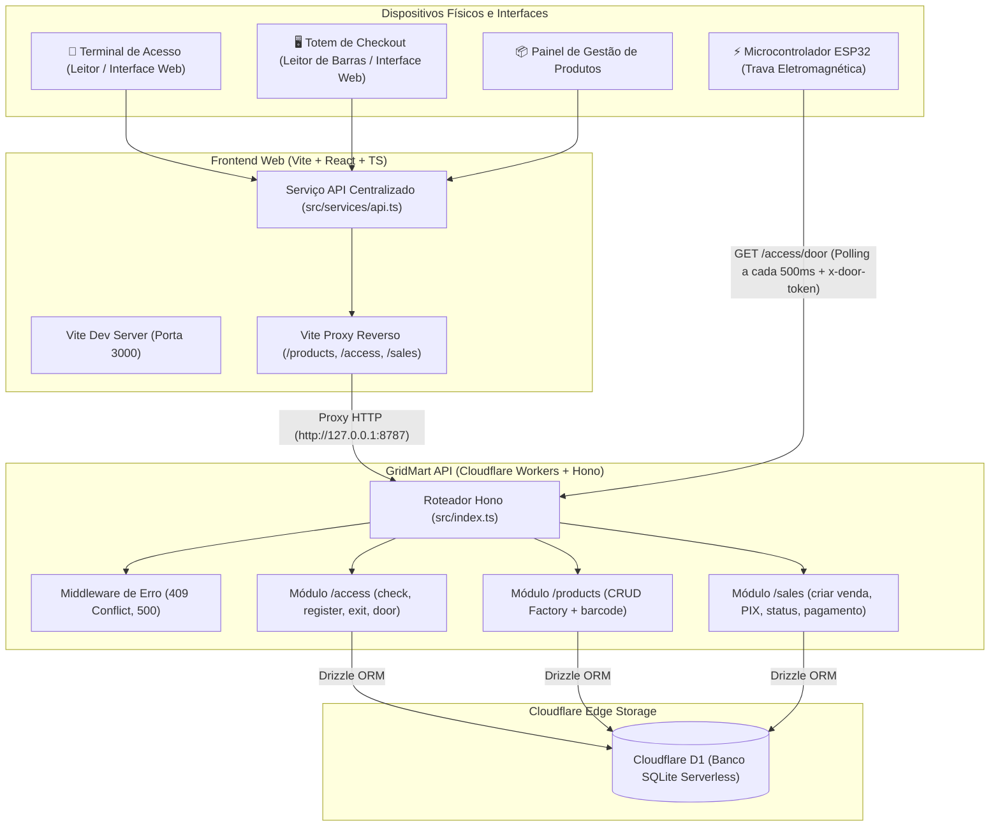
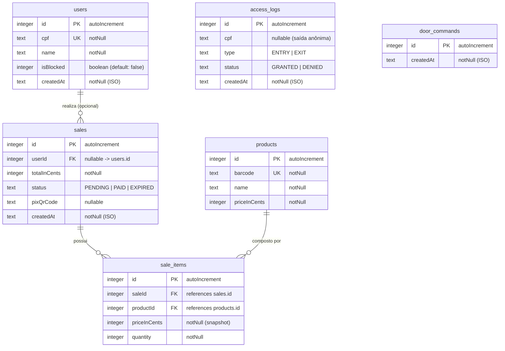

# 🛒 GridMart - Solução Integrada de Mercado Autônomo

> **Ecossistema Completo para Lojas Autônomas e Mercados Inteligentes (Honest Market / Micromarket)**  
> Abrangendo **Frontend Web (Totem & Gestão)**, **Backend API Edge-Native** e **Firmware IoT (ESP32)**.

O **GridMart** é uma plataforma ponta a ponta projetada para operar lojas físicas 100% autônomas sem a necessidade de atendentes. A solução integra três pilares fundamentais:
1. **Frontend Web**: Totem de autoatendimento para compras e pagamentos via Pix em tempo real, interface de controle de acesso (leitor de CPF para liberação de portas) e painel administrativo para catálogo de produtos.
2. **Backend API (Edge-Native)**: API de altíssima performance construída com [Hono](https://hono.dev), [Drizzle ORM](https://orm.drizzle.team) e [Cloudflare Workers](https://workers.cloudflare.com) com banco de dados relacional distribuído [Cloudflare D1](https://developers.cloudflare.com/d1/) (SQLite na borda).
3. **Hardware & Firmware IoT (ESP32)**: Controle automatizado da trava eletromagnética da porta física da loja através de fila assíncrona de comandos com polling seguro autenticado por token.

---

## 📑 Índice

- [💡 Visão Geral e Conceito](#-visão-geral-e-conceito)
- [🏛️ Arquitetura Integrada do Sistema](#️-arquitetura-integrada-do-sistema)
- [🛠️ Stacks Tecnológicas](#️-stacks-tecnológicas)
- [🛒 Módulo Backend API (`gridmart-api`)](#-módulo-backend-api-gridmart-api)
  - [Estrutura do Backend](#estrutura-do-backend)
  - [Middlewares e Utilitários](#middlewares-e-utilitários)
  - [Novidades e Reestruturação Recente](#novidades-e-reestruturação-recente)
- [🗄️ Modelagem do Banco de Dados (Schema D1)](#️-modelagem-do-banco-de-dados-schema-d1)
  - [Diagrama Entidade-Relacionamento](#diagrama-entidade-relacionamento)
  - [Detalhamento das Tabelas](#detalhamento-das-tabelas)
- [📡 Documentação das Rotas da API](#-documentação-das-rotas-da-api)
  - [Módulo de Produtos (`/products`)](#módulo-de-produtos-products)
  - [Módulo de Acesso (`/access`)](#módulo-de-acesso-access)
  - [Módulo de Vendas (`/sales`)](#módulo-de-vendas-sales)
- [⚡ Firmware IoT e Automação da Trava (ESP32)](#-firmware-iot-e-automação-da-trava-esp32)
- [🖥️ Módulo Frontend (`gridmart-frontend`)](#️-módulo-frontend-gridmart-frontend)
  - [Funcionalidades Principais](#funcionalidades-principais)
  - [Integração e Comunicação HTTP](#integração-e-comunicação-http)
  - [Configuração de Proxy e `.env`](#configuração-de-proxy-e-env)
- [💎 Convenções e Boas Práticas Adotadas](#-convenções-e-boas-práticas-adotadas)
- [🚀 Guia de Configuração e Execução Local](#-guia-de-configuração-e-execução-local)
  - [1. Executando o Backend (API)](#1-executando-o-backend-api)
  - [2. Executando o Frontend (Web)](#2-executando-o-frontend-web)
  - [3. Testes Automatizados e Build](#3-testes-automatizados-e-build)
- [📄 Licença](#-licença)

---

## 💡 Visão Geral e Conceito

O GridMart atende aos principais fluxos de operação de uma loja física autônoma:

```
[ Entrada / Acesso ]           [ Totem de Compras ]             [ Hardware IoT ]
  Validação de CPF  ───────►   Leitor de Código de Barras  ───►    ESP32 consome
  Libera ou Cadastra           Carrinho & QR Code Pix             fila e abre trava
```

1. **Controle de Acesso da Trava da Porta**:
   - O cliente informa o CPF no terminal/leitor da entrada.
   - O sistema valida o CPF através do algoritmo oficial da Receita Federal (módulo 11) e verifica se o usuário está cadastrado e ativo (`isBlocked = false`).
   - Se autorizado, um comando de destravamento é enfileirado na tabela `door_commands` e a tentativa é registrada em `access_logs` com status `GRANTED` (ou `DENIED` caso bloqueado).
   - Se o cliente ainda não for cadastrado, a interface possibilita o cadastro instantâneo de nome e CPF, liberando o acesso em seguida.
   - Para saída, o sistema registra o log e enfileira a liberação imediata (com CPF opcional).

2. **Autoatendimento & Checkout no Totem**:
   - Busca veloz de produtos no catálogo por leitura de código de barras (`barcode`) ou seleção direta na interface.
   - Montagem do carrinho em tempo real com controle de quantidades.
   - Criação da venda vinculada aos itens, com suporte tanto para compras anônimas quanto identificadas por `userId` com validação de existência do cliente.
   - Geração dinâmica do **QR Code PIX** (código copia-e-cola EMV com valor formatado e timestamp) renderizado via canvas/SVG.
   - Confirmação de pagamento manual no totem ou via webhook/integração.

3. **Gestão do Catálogo de Produtos**:
   - Criação, edição, exclusão e visualização de produtos com nome, código de barras e preços armazenados rigorosamente em centavos.
   - Arquitetura baseada em factory genérica reutilizável de CRUD.

---

## 🏛️ Arquitetura Integrada do Sistema

O diagrama a seguir ilustra a comunicação entre a interface web, o microcontrolador ESP32, o backend edge-native e o banco de dados distribuído:



---

## 🛠️ Stacks Tecnológicas

### Backend & IoT (`gridmart-api`)
| Tecnologia | Função no Projeto | Justificativa / Benefício |
| :--- | :--- | :--- |
| **[Hono](https://hono.dev/)** (`^4.13.2`) | Framework Web | Framework minimalista e ultrarrápido projetado para ambientes serverless e Edge runtimes |
| **[Cloudflare Workers](https://workers.cloudflare.com/)** | Runtime Serverless | Execução distribuída globalmente na borda com latência próxima de zero |
| **[Cloudflare D1](https://developers.cloudflare.com/d1/)** | Banco de Dados Relacional | Banco SQL serverless distribuído baseado em SQLite nativo da Cloudflare |
| **[Drizzle ORM](https://orm.drizzle.team/)** (`^0.45.2`) | ORM / Query Builder | Totalmente type-safe, leve, sem overhead e com suporte de primeira classe ao Cloudflare D1 |
| **[Zod](https://zod.dev/) & [Drizzle-Zod](https://orm.drizzle.team/docs/zod)** | Validação de Schemas | Validação declarativa do payload de requisições HTTP integradas via `@hono/zod-validator` |
| **[Bun](https://bun.sh/)** | Runtime & Test Runner | Runtime JavaScript ultrarrápido utilizado para desenvolvimento e testes unitários com `bun test` |
| **[ESP32 (Arduino C++)](https://www.espressif.com/)** | Firmware IoT | Microcontrolador que consome comandos da fila e aciona o relé da trava eletromagnética |

### Frontend (`gridmart-frontend`)
| Tecnologia | Versão | Função no Projeto |
| :--- | :--- | :--- |
| **[React](https://react.dev/)** | `18.3.1` | Biblioteca de componentes declarativos para interface de usuário |
| **[TypeScript](https://www.typescriptlang.org/)** | `5.6.3` | Tipagem estática fim a fim com interfaces unificadas para a API |
| **[Vite](https://vitejs.dev/)** | `6.0.1` | Build tool ultrarrápido, HMR instantâneo e servidor de desenvolvimento com proxy integrado |
| **[qrcode.react](https://github.com/zpao/qrcode.react)** | `4.2.0` | Renderização nativa em canvas/SVG do QR Code Pix para pagamento no totem |
| **CSS3 Puro (Design System)** | Custom | Estilização moderna, responsiva, com variáveis CSS, micro-animações e feedback visual |

---

## 🛒 Módulo Backend API (`gridmart-api`)

### Estrutura do Backend

```
gridmart-api/
├── src/
│   ├── db/
│   │   └── schema.ts                   # Definição das tabelas com Drizzle ORM
│   ├── middlewares/
│   │   └── errorHandler.ts             # Tratamento de erros: 409 (UNIQUE constraint), 500
│   ├── modules/
│   │   ├── access/
│   │   │   └── access.routes.ts        # check, register, exit, door (polling do ESP32)
│   │   ├── products/
│   │   │   └── products.routes.ts      # CRUD via factory genérica + busca por barcode
│   │   └── sales/
│   │       └── sales.routes.ts         # Criação de venda, validação de comprador e Pix
│   ├── utils/
│   │   ├── api.ts                      # Tipos de Env, helper db(), idParam() e or404()
│   │   ├── cpf.ts                      # Validação de CPF (algoritmo oficial módulo 11)
│   │   ├── cpf.test.ts                 # Testes unitários do validador (Bun Test)
│   │   └── crud.ts                     # Factory de CRUD genérico reutilizável para Drizzle
│   └── index.ts                        # Ponto de entrada: registro de rotas e middlewares
├── esp32/
│   └── door_lock.ino                   # Firmware do ESP32 com polling e controle de relé
├── drizzle/                            # Migrações SQL versionadas geradas pelo Drizzle Kit
│   ├── 0000_long_thor_girl.sql
│   ├── 0001_dry_inhumans.sql           # Migração: door_commands e campos em access_logs
│   └── 0002_breezy_demogoblin.sql      # Migração: userId e enums na tabela sales
├── drizzle.config.ts                   # Configuração do Drizzle Kit para SQLite
├── wrangler.jsonc                      # Configuração do Cloudflare Workers, D1 e variáveis
├── package.json                        # Scripts e dependências do backend
└── tsconfig.json                       # Configuração TypeScript do backend
```

### Middlewares e Utilitários

- **[`errorHandler.ts`](file:///c:/Users/Usuario/gridmart-api/src/middlewares/errorHandler.ts)**: Middleware global de erro do Hono (`app.onError(errorHandler)`). Inspeciona recursivamente `err.message` e `err.cause` procurando violações de unicidade (`UNIQUE constraint failed`) do SQLite. Retorna `409 Conflict` com payload `{ "error": "Conflito: registro já existe" }` em vez de expor erros internos ou `500`.
- **[`crud.ts`](file:///c:/Users/Usuario/gridmart-api/src/utils/crud.ts)**: Factory genérica `crud(app, table)` que registra automaticamente as rotas `GET /`, `GET /:id`, `POST /`, `PUT /:id` e `DELETE /:id` para qualquer tabela Drizzle com esquemas derivados via `drizzle-zod`.
- **[`api.ts`](file:///c:/Users/Usuario/gridmart-api/src/utils/api.ts)**:
  - `Env`: Tipagem com bindings `DB: D1Database` e `DOOR_TOKEN: string`.
  - `db(c)`: Instancia o cliente Drizzle conectado ao D1.
  - `idParam(c)`: Valida e extrai o `:id` numérico positivo inteiro (`Number.isInteger(v) && v > 0`).
  - `or404(c, item)`: Helper padronizado que retorna o registro ou erro `404 Not Found`.
- **[`cpf.ts`](file:///c:/Users/Usuario/gridmart-api/src/utils/cpf.ts)**: Implementação do algoritmo oficial módulo 11 da Receita Federal com suite de testes em [`cpf.test.ts`](file:///c:/Users/Usuario/gridmart-api/src/utils/cpf.test.ts).

### Novidades e Reestruturação Recente

1. **Fila Assíncrona de Hardware (`door_commands`)**: Desacoplamento total entre requisições HTTP de entrada/saída e o hardware físico. O ESP32 agora consome comandos em FIFO via polling seguro com token de cabeçalho (`x-door-token`).
2. **Refatoração do Módulo de Produtos com Factory Genérica (`crud.ts`)**: Eliminação de código boilerplate duplicado. O módulo de produtos reduziu para 13 linhas mantendo suporte completo a CRUD e busca dedicada por código de barras.
3. **Vínculo e Validação de Comprador nas Vendas**: A tabela `sales` passou a aceitar `userId` opcional. Quando informado, o backend valida a existência prévia do cliente na tabela `users`, retornando `404 Not Found` caso o ID não exista.
4. **Abstração e Geração Padronizada do Pix**: Implementação do gerador `buildPix(totalInCents)` que encapsula a estrutura EMV BR Code com valor em reais formatado e timestamp dinâmico.
5. **Auditoria Refinada de Acesso**: Adicionado o campo `type` (`ENTRY` | `EXIT`) e CPF opcional para registro de saídas.
6. **Segurança e Variáveis de Ambiente**: Introdução da variável `DOOR_TOKEN` no [`wrangler.jsonc`](file:///c:/Users/Usuario/gridmart-api/wrangler.jsonc) para autenticar requisições de hardware.

---

## 🗄️ Modelagem do Banco de Dados (Schema D1)

### Diagrama Entidade-Relacionamento



### Detalhamento das Tabelas

#### 1. `users` (Clientes da Loja)
Controla os usuários habilitados a entrar na loja física:
- `id` (`INTEGER`, Primary Key, Auto Increment)
- `cpf` (`TEXT`, Not Null, Unique): CPF limpo do cliente para liberação da porta.
- `name` (`TEXT`, Not Null): Nome completo.
- `isBlocked` (`INTEGER` / boolean, Default: `false`): Bloqueio por pendência ou suspensão.
- `createdAt` (`TEXT`, Not Null): Timestamp de cadastro em formato ISO 8601.

#### 2. `access_logs` (Auditoria da Fechadura)
Histórico completo de entradas e saídas:
- `id` (`INTEGER`, Primary Key, Auto Increment)
- `cpf` (`TEXT`, Nullable): CPF informado (pode ser `null` em saídas sem identificação).
- `type` (`TEXT`, Not Null): `'ENTRY'` (entrada) ou `'EXIT'` (saída).
- `status` (`TEXT`, Not Null): `'GRANTED'` (liberado) ou `'DENIED'` (negado).
- `createdAt` (`TEXT`, Not Null): Data/hora do evento.

#### 3. `products` (Catálogo de Mercadorias)
Produtos lidos pelo leitor de código de barras ou catálogo:
- `id` (`INTEGER`, Primary Key, Auto Increment)
- `barcode` (`TEXT`, Not Null, Unique): Código de barras (EAN-13, UPC, etc.).
- `name` (`TEXT`, Not Null): Descrição comercial do produto.
- `priceInCents` (`INTEGER`, Not Null): Preço unitário em centavos (ex: R$ 5,50 = 550).

#### 4. `sales` (Cabeçalho de Vendas)
Transações geradas no totem de checkout:
- `id` (`INTEGER`, Primary Key, Auto Increment)
- `userId` (`INTEGER`, Nullable, FK → `users.id`): Comprador identificado (`null` = anônimo).
- `totalInCents` (`INTEGER`, Not Null): Valor total da compra em centavos.
- `status` (`TEXT`, Not Null): `'PENDING'`, `'PAID'` ou `'EXPIRED'`.
- `pixQrCode` (`TEXT`, Nullable): Payload EMV do QR Code Pix gerado.
- `createdAt` (`TEXT`, Not Null): Timestamp de abertura da venda.

#### 5. `sale_items` (Itens da Venda)
Relação de itens vinculados ao pedido:
- `id` (`INTEGER`, Primary Key, Auto Increment)
- `saleId` (`INTEGER`, Not Null, FK → `sales.id`)
- `productId` (`INTEGER`, Not Null, FK → `products.id`)
- `priceInCents` (`INTEGER`, Not Null): **Snapshot** do preço no ato da venda.
- `quantity` (`INTEGER`, Not Null): Quantidade comprada.

#### 6. `door_commands` (Fila de Liberação da Trava)
Fila consumida pelo microcontrolador ESP32 via polling:
- `id` (`INTEGER`, Primary Key, Auto Increment)
- `createdAt` (`TEXT`, Not Null): Timestamp de inclusão do comando.

---

## 📡 Documentação das Rotas da API

### Módulo de Produtos (`/products`)

Gerenciado pela factory genérica [`crud.ts`](file:///c:/Users/Usuario/gridmart-api/src/utils/crud.ts) com rota complementar de código de barras:

| Método | Endpoint | Descrição | Status de Sucesso | Status de Erro |
| :--- | :--- | :--- | :--- | :--- |
| `GET` | `/products` | Lista catálogo completo | `200 OK` | - |
| `GET` | `/products/:id` | Busca produto pelo ID numérico | `200 OK` | `404 Not Found` |
| `GET` | `/products/barcode/:barcode` | Busca produto pelo código de barras | `200 OK` | `404 Not Found` |
| `POST` | `/products` | Cadastra novo produto | `201 Created` | `400 Bad Request` / `409 Conflict` |
| `PUT` | `/products/:id` | Atualiza dados parciais de produto | `200 OK` | `404 Not Found` / `409 Conflict` |
| `DELETE` | `/products/:id` | Exclui produto do catálogo | `200 OK` | `404 Not Found` |

#### Exemplo de Criação (`POST /products`):
```bash
POST /products
Content-Type: application/json

{
  "barcode": "7891000100103",
  "name": "Refrigerante Coca-Cola 350ml",
  "priceInCents": 550
}
```
*Resposta `201 Created`:*
```json
{
  "id": 1,
  "barcode": "7891000100103",
  "name": "Refrigerante Coca-Cola 350ml",
  "priceInCents": 550
}
```

---

### Módulo de Acesso (`/access`)

Implementado em [`access.routes.ts`](file:///c:/Users/Usuario/gridmart-api/src/modules/access/access.routes.ts):

| Método | Endpoint | Descrição | Status de Sucesso | Status de Erro |
| :--- | :--- | :--- | :--- | :--- |
| `POST` | `/access/check` | Valida CPF para liberação de entrada | `200 OK` | `400 Bad Request` / `403 Forbidden` |
| `POST` | `/access/register` | Cadastra novo cliente e enfileira abertura | `201 Created` | `400 Bad Request` / `409 Conflict` |
| `POST` | `/access/exit` | Registra saída e enfileira abertura | `200 OK` | `400 Bad Request` |
| `GET` | `/access/door` | Consome 1º comando da fila (polling ESP32) | `200 OK` | `401 Unauthorized` |

#### Exemplos Detalhados:

- **`POST /access/check`**:
  - Request:
    ```json
    { "cpf": "529.982.247-25" }
    ```
  - *Usuário cadastrado e ativo (`200 OK`):*
    ```json
    { "registered": true, "allowed": true, "name": "João Silva" }
    ```
  - *Usuário bloqueado (`403 Forbidden`):*
    ```json
    { "registered": true, "allowed": false, "error": "Acesso bloqueado" }
    ```
  - *Usuário não encontrado (`200 OK`):*
    ```json
    { "registered": false, "allowed": false }
    ```

- **`POST /access/register`**:
  - Request:
    ```json
    { "cpf": "529.982.247-25", "name": "Maria Oliveira" }
    ```
  - *Resposta (`201 Created`):*
    ```json
    { "registered": true, "allowed": true, "name": "Maria Oliveira" }
    ```

- **`POST /access/exit`**:
  - Request (CPF opcional):
    ```json
    { "cpf": "529.982.247-25" }
    ```
  - *Resposta (`200 OK`):*
    ```json
    { "allowed": true }
    ```

- **`GET /access/door`** *(Autenticado por cabeçalho `x-door-token`)*:
  - Header obrigatório: `x-door-token: dev-token-mude-me-antes-de-deployar`
  - Se houver comando pendente na fila: retorna `200 OK` com o objeto e **deleta atomicamente** o comando:
    ```json
    { "id": 14, "createdAt": "2026-09-24T23:56:00.000Z" }
    ```
  - Se a fila estiver vazia: retorna `200 OK` com corpo `null`.
  - Token incorreto ou ausente: retorna `401 Unauthorized`:
    ```json
    { "error": "Não autorizado" }
    ```

---

### Módulo de Vendas (`/sales`)

Implementado em [`sales.routes.ts`](file:///c:/Users/Usuario/gridmart-api/src/modules/sales/sales.routes.ts):

| Método | Endpoint | Descrição | Status de Sucesso | Status de Erro |
| :--- | :--- | :--- | :--- | :--- |
| `POST` | `/sales` | Cria venda, valida comprador e gera Pix | `201 Created` | `400 Bad Request` / `404 Not Found` |
| `GET` | `/sales/:id` | Consulta status e detalhes do pedido | `200 OK` | `404 Not Found` |
| `POST` | `/sales/:id/pay` | Confirma o pagamento (status → `PAID`) | `200 OK` | `404 Not Found` |

#### Exemplo de Criação de Venda (`POST /sales`):
```json
// Request
{
  "userId": 1,
  "items": [
    { "productId": 1, "quantity": 2 },
    { "productId": 2, "quantity": 1 }
  ]
}
```
*Resposta `201 Created`:*
```json
{
  "id": 10,
  "userId": 1,
  "totalInCents": 1890,
  "status": "PENDING",
  "pixQrCode": "00020126580014br.gov.bcb.pix0136gridmart-1790294400000520400005303986540518.905802BR5908GRIDMART6009SAOPAULO62070503***6304",
  "createdAt": "2026-09-24T23:57:00.000Z",
  "items": [
    { "productId": 1, "quantity": 2, "priceInCents": 550 },
    { "productId": 2, "quantity": 1, "priceInCents": 790 }
  ]
}
```

> [!NOTE]
> Se o `userId` for informado e não existir na tabela `users`, a API retorna `404 Not Found` com `{ "error": "Comprador não encontrado" }`. Da mesma forma, se algum `productId` não existir no catálogo, retorna `404 Not Found` com `{ "error": "Produto X não encontrado" }`.

---

## ⚡ Firmware IoT e Automação da Trava (ESP32)

O firmware do microcontrolador está implementado em [`esp32/door_lock.ino`](file:///c:/Users/Usuario/gridmart-api/esp32/door_lock.ino).

### Fluxo Operacional do Hardware

```
                      [ Inicialização ESP32 ]
                                 │
                        Conecta ao Wi-Fi
                                 ▼
                     ┌───────────────────────┐
                     │ Loop a cada 500ms     │
                     └──────────┬────────────┘
                                │
             ┌──────────────────┴──────────────────┐
             ▼                                     ▼
   Porta aberta há > 6s?                 Porta está fechada?
             │                                     │
   Sim ──► Desliga Relé                  Sim ──► Faz GET /access/door
           (Tranca a porta)                      (com header x-door-token)
                                                   │
                                          ┌────────┴────────┐
                                          ▼                 ▼
                                    HTTP 200 c/ ID    HTTP 200 body null
                                          │                 │
                                    Liga o Relé por 6s    Faz nada
                                    (Destrava a porta)    (Mantém trancada)
```

### Principais Vantagens do Modelo Polling:
1. **Dispensa IP Fixo ou Port Forwarding**: O ESP32 atua como cliente HTTP, funcionando atrás de qualquer roteador ou NAT residencial/comercial.
2. **Proteção Contra Batimento de Porta**: A trava permanece aberta por 6 segundos (`OPEN_MS = 6000`). Se múltiplos clientes forem autorizados consecutivamente, a porta permanece destravada sem bater nas pessoas.
3. **Autenticação Segura**: Polling protegido por token configurável em `DOOR_TOKEN`.

```cpp
// Trecho de esp32/door_lock.ino
const char* ssid      = "WIFI_DA_LOJA";
const char* password  = "SENHA_DO_WIFI";
const char* apiUrl    = "https://gridmart-api.seu-dominio.workers.dev/access/door";
const char* doorToken = "MESMO_TOKEN_DA_VAR_DOOR_TOKEN";

const int   RELAY_PIN = 23;      // GPIO do módulo relé
const unsigned long POLL_MS = 500;  // Polling a cada 500ms
const unsigned long OPEN_MS = 6000; // Tempo de destravamento (6s)
```

---

## 🖥️ Módulo Frontend (`gridmart-frontend`)

### Funcionalidades Principais

1. **Totem de Autoatendimento**:
   - Foco inteligente para leitores de código de barras USB/Bluetooth.
   - Grade de catálogo com busca rápida e adição ao carrinho.
   - Modal com renderização do QR Code Pix em canvas SVG e botão de confirmação.
2. **Controle de Acesso**:
   - Terminal simulador de entrada e saída.
   - Máscara e validação de dígitos de CPF.
   - Fluxo de liberação imediata ou cadastro em tela com liberação automática.
3. **Gestão de Produtos**:
   - CRUD completo de mercadorias com conversão automática de reais (`R$`) para centavos (`priceInCents`).

### Integração e Comunicação HTTP

Cliente centralizado em [`src/services/api.ts`](file:///c:/Users/Usuario/gridmart--front-end/src/services/api.ts):

| Função no Frontend | Método HTTP | Rota Correspondente na API | Objetivo |
| :--- | :--- | :--- | :--- |
| `api.getProducts()` | `GET` | `/products` | Lista catálogo completo |
| `api.getProductById(id)` | `GET` | `/products/:id` | Busca produto por ID |
| `api.getProductByBarcode(code)` | `GET` | `/products/barcode/:code`| Busca por código de barras no totem |
| `api.createProduct(data)` | `POST` | `/products` | Cadastra novo produto |
| `api.updateProduct(id, data)` | `PUT` | `/products/:id` | Atualiza produto existente |
| `api.deleteProduct(id)` | `DELETE` | `/products/:id` | Remove produto do catálogo |
| `api.checkAccess(cpf)` | `POST` | `/access/check` | Valida CPF e libera entrada |
| `api.registerUser(cpf, name)` | `POST` | `/access/register` | Cadastra cliente e libera entrada |
| `api.exitAccess(cpf?)` | `POST` | `/access/exit` | Registra saída e libera porta |
| `api.createSale(items, userId?)` | `POST` | `/sales` | Inicia venda e gera Pix |
| `api.getSale(id)` | `GET` | `/sales/:id` | Consulta status do pedido |
| `api.paySale(id)` | `POST` | `/sales/:id/pay` | Confirma o pagamento da venda |

### Configuração de Proxy e `.env`

O servidor de desenvolvimento do Vite utiliza proxy reverso para evitar problemas de CORS:

```typescript
// vite.config.ts
export default defineConfig({
  plugins: [react()],
  server: {
    port: 3000,
    proxy: {
      "/products": { target: "http://127.0.0.1:8787", changeOrigin: true },
      "/access":   { target: "http://127.0.0.1:8787", changeOrigin: true },
      "/sales":    { target: "http://127.0.0.1:8787", changeOrigin: true },
    },
  },
});
```

---

## 💎 Convenções e Boas Práticas Adotadas

1. **Preços Inteiros em Centavos (`priceInCents`, `totalInCents`)**: Previne imprecisões de ponto flutuante inerentes ao IEEE 754 (`R$ 19,99` = `1999`).
2. **Snapshot Contábil na Venda**: O preço gravado em `sale_items.priceInCents` é congelado no momento da compra, preservando a integridade contábil mesmo após alterações futuras no catálogo.
3. **Fila Desacoplada e Polling IoT (`door_commands`)**: Comunicação segura e não-bloqueante com hardware físico na borda.
4. **Tratamento Específico de Conflitos (`409 Conflict`)**: O middleware [`errorHandler.ts`](file:///c:/Users/Usuario/gridmart-api/src/middlewares/errorHandler.ts) detecta falhas de constraint única e emite mensagens amigáveis em vez de erro `500`.
5. **Factory Genérica de CRUD (`crud.ts`)**: Reutilização de código com derivação automática de esquemas Zod e type-safety fim a fim.
6. **Validação Rigorosa de CPF**: Algoritmo oficial módulo 11 testado unitariamente via `bun test`.

---

## 🚀 Guia de Configuração e Execução Local

### Pré-requisitos
- [Node.js](https://nodejs.org/) (versão 18+)
- [Bun](https://bun.sh/) (para runtime rápido e testes)
- [Wrangler CLI](https://developers.cloudflare.com/workers/wrangler/)

---

### 1. Executando o Backend (API)

No diretório [`gridmart-api`](file:///c:/Users/Usuario/gridmart-api):

```bash
# 1. Instalar dependências
bun install

# 2. Gerar migrações D1 (se houver alteração em schema.ts)
bun run db:generate

# 3. Aplicar as migrações no banco local SQLite/D1
bun run db:migrate

# 4. Iniciar o servidor Edge local
bun run dev
```

> A API estará disponível em: **`http://localhost:8787`** (ou `http://127.0.0.1:8787`).

---

### 2. Executando o Frontend (Web)

No diretório do frontend (`gridmart--front-end`):

```bash
# 1. Instalar dependências
npm install

# 2. Iniciar servidor Vite
npm run dev
```

> A aplicação estará acessível em: **`http://localhost:3000`**.

---

### 3. Testes Automatizados e Build

#### Backend:
```bash
# Executar testes unitários (validador de CPF, etc.)
bun test

# Verificação estática de tipos
bun run typecheck

# Deploy para produção na Cloudflare
bun run deploy
```

#### Frontend:
```bash
# Build de produção do frontend
npm run build

# Pré-visualização do bundle gerado
npm run preview
```

---

## 📄 Licença

Este projeto é disponibilizado sob os termos da licença [MIT](file:///c:/Users/Usuario/gridmart-api/LICENSE).
